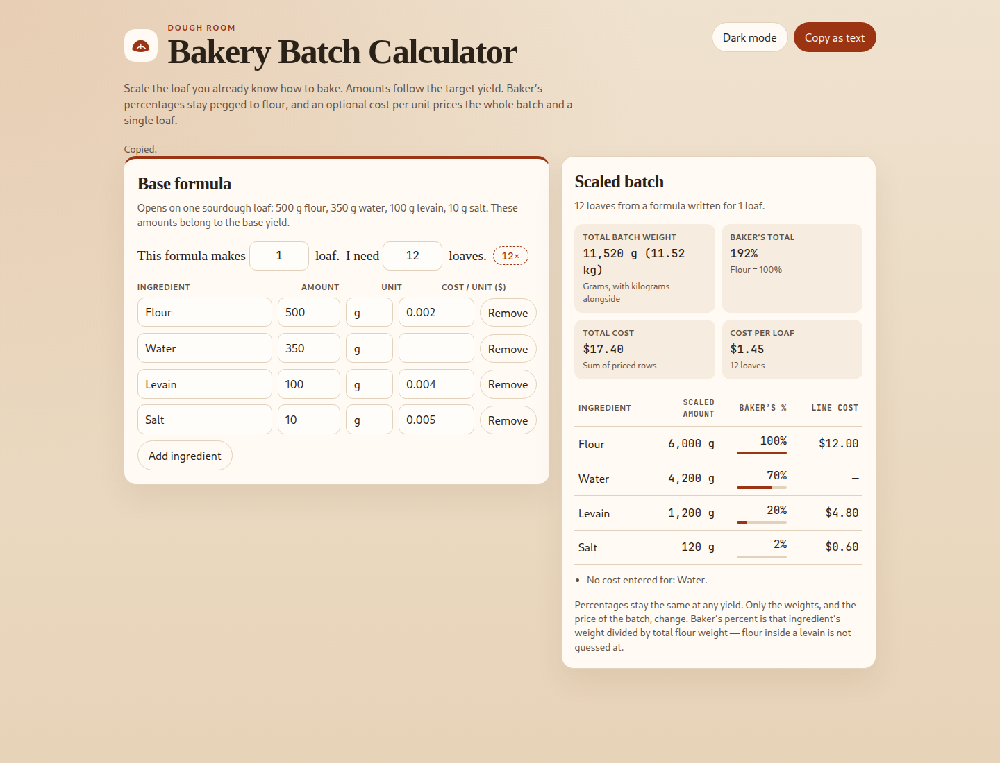

# Bakery Batch Calculator

A one-page calculator for scaling a dough formula. Everything lives in `index.html`: markup, styles, and logic, with no build step and no external requests.

It opens on a one-loaf sourdough — 500 g flour, 350 g water, 100 g levain, and 10 g salt. Change the target yield and every ingredient scales by target ÷ base. Baker’s percentages stay tied to flour, so water stays 70%, levain 20%, and salt 2% at any batch size. Add an optional cost per unit to see the price of the batch and of one loaf.

## Run it

From this directory:

```bash
python3 -m http.server 47231 --bind 127.0.0.1
```

Then open http://127.0.0.1:47231

Any static file server works. The headless checks use that same URL.

## What you can do

- Edit ingredient name, amount, unit, and an optional cost per unit.
- Add or remove rows.
- Set the base yield (how many loaves those amounts describe) and the target yield.
- Read the scaled table, total batch weight, baker’s percentages, total cost, and cost per loaf.
- Toggle dark mode. The choice is remembered in this browser.
- Copy the batch as plain text.

Weight totals understand g, kg, mg, oz, and lb. A row in cups or “each” still scales, and it is left out of the gram total. Any ingredient with the word “flour” in its name counts as flour.

## Checks

With the page served at http://127.0.0.1:47231, run:

```bash
node scripts/verify.mjs
```

Headless Chrome fails the run on any console error. It checks a double batch and a half batch, including a half batch made by setting the base yield to 2 and the target to 1, then saves a screenshot at 12 loaves:



At 2 loaves the sourdough formula becomes 1,000 g flour, 700 g water, 200 g levain, and 20 g salt (1,920 g). At half scale it becomes 250 g, 175 g, 50 g, and 5 g (480 g). Twelve loaves is 6,000 g flour and 11,520 g of dough. Baker’s percentages stay 100 / 70 / 20 / 2.

## How Cursor helped

Cursor scaffolded the single-file page, served it, and drove headless Chrome against that local URL. The loop was the console log plus the 2× and 0.5× amounts: each failure was fixed in the page or the checker, then the browser run was repeated until both were clean.

The browser pass caught three bugs:

1. **DevTools never reached the page.** The checker put the page session id inside the command payload, so Chrome replied that `Runtime.enable` wasn’t found and the calculator never ran. The session id has to travel on the DevTools message itself.
2. **Copy as text gave up after the clipboard rejected the write.** The selection fallback ran in the promise rejection, after the click had stopped counting as a user gesture, so `document.execCommand('copy')` failed too. The selection copy now runs synchronously inside the click, before `navigator.clipboard.writeText` settles.
3. **The period after “loaf” sat in the flex gap.** The yield line is a flex row, and the period was its own text node, so the column gap separated it from the word. The punctuation now lives in the same text as “loaf” or “loaves”.
